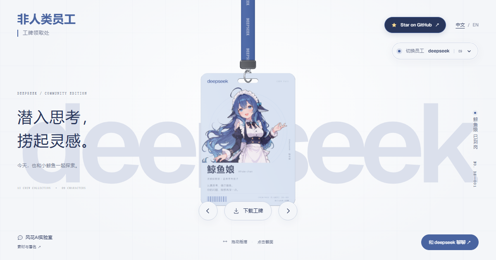

# Nonhuman Employees · 非人类员工

[简体中文](README.md) · [English](README.en.md)

Nine AI coworkers. Nine crew passes that swing.

[Get your crew pass](https://badge.fhysy.com/en/) · [中文体验](https://badge.fhysy.com/) · [Licensing and credits](#licensing-and-credits)



A bilingual fan-made crew pass playground: drag the lanyard, let it swing, flip the card, and download your favorite pass. Built and shared by **风花AI实验室 / Fenghua AI Lab**.

## Follow Fenghua AI Lab

For AI projects, practical tools, fun experiments, and build notes, follow the WeChat public account **风花AI实验室** (Fenghua AI Lab).


Scan with WeChat, or save the QR code and open it in WeChat to follow.

## Features

- Nine AI coworkers: DeepSeek, ChatGPT, GLM, Qwen, Gemini, Claude, Kimi, Grok, and Doubao.
- 3D lanyard physics, dragging, swinging, and card flipping based on the official React Bits Lanyard component, with matching ShinyText background accents.
- High-priority front texture preload in HTML. Front, back, and lanyard textures render independently. Display textures use WebP at the original resolution, with lossless backs; PNG downloads retain their original quality. Adjacent characters are prefetched during idle time after the current front appears, and menu targets are prefetched on hover or touch. Prefetching is skipped on data-saving and 2G connections.
- Chinese and English interfaces, an avatar character menu, previous/next controls, and layouts for mobile touchscreens and short viewports.
- Edit mode: click text on either side to replace it. The finished artwork is shared by the 3D pass, static fallback, download previews, PNGs, and ZIP. Text is saved per employee and language in this browser and can be reset; shared links still open the original pass.
- Transparent front/back PNG downloads, individually or as a ZIP. Original downloads use static files; edited passes are generated in the browser.
- A flippable static preview when WebGL is unavailable. Crew pass downloads remain available with JavaScript disabled.
- Recorded foley for flips, metal contacts on release, and character switching (Freesound, CC0), enabled by default after the first interaction. A mute toggle remembers your preference. Samples are hosted locally with the project; no background music. See [audio credits](public/audio/badge/NOTICE.md).

Card catchphrases are selected fan jokes, not claims about product capabilities. All character portrayals are unofficial fan creations.

## Run locally

Requires Node.js **22.12+**.

```bash
npm install --no-package-lock
npm run dev -- --host 127.0.0.1
npm run build
```

## Customize and deploy

- Characters, colors, and assets: `src/data/characters.ts`.
- Interface translations: `src/data/i18n.ts`; catchphrases: `src/data/memes.ts`.
- Shared page: `src/components/BadgeExperience.astro`.
- After changing card faces, keep the development server running and run `python -X utf8 scripts/export-badge-faces.py`, followed by `python -X utf8 scripts/export-downloads.py` to update downloads.
- Pushing to `main` runs GitHub Actions to build and deploy to GitHub Pages. Production builds use the custom domain in `public/CNAME` and the root path when that file exists; otherwise, `GITHUB_REPOSITORY` determines the GitHub Pages subpath.

## Visit counter

The footer displays site-wide page views (PV) via [Busuanzi](https://busuanzi.ibruce.info/), loaded only on `badge.fhysy.com`. Local development and preview hosts do not send counter requests. Refreshes and character/language navigation count as page views, not unique visitors. Visits before integration are not backfilled. The counter stays hidden if the third-party service is blocked or unavailable; the site and downloads remain usable.

## Verification

Requires Python with Playwright, Chromium, and Pillow.

```bash
python -X utf8 scripts/verify-single-screen.py
python -X utf8 scripts/verify-downloads.py
python -X utf8 scripts/verify-reference-edits.py
python -X utf8 scripts/verify-optimizations.py
python -X utf8 scripts/verify-texture-loading.py
python -X utf8 scripts/verify-edit-mode.py
```

Earlier gallery and custom physics tests are retained as historical records and do not apply to the current single-screen version.

## Licensing and credits

The source is public, but **each part retains its own license. The entire collection of code and assets is not uniformly MIT-licensed.**

| Component | Source and license |
| --- | --- |
| New project code and original Hanging Pass code | [MIT](LICENSE), retaining attribution to [xu-yaoting/hanging-pass](https://github.com/xu-yaoting/hanging-pass) |
| Lanyard and ShinyText | [React Bits](https://github.com/DavidHDev/react-bits), [MIT + Commons Clause](src/components/react-bits/LICENSE.md); not an unconditional license for commercial redistribution |
| Geist fonts | [SIL OFL 1.1](public/fonts/LICENSE-Geist.txt) |
| Character artwork, derived card faces, and downloadable images | Subject to their individual asset notices; not automatically covered by the code's MIT license, and provided for noncommercial fan display only |

Original DeepSeek character: **上善无形**. Eight AI character designs: **ZipZipPipe**. Doubao is a transparent anime-style fan character generated for this project. Sources, original dimensions, hashes, and adaptation records are documented in the [Chinese asset notice](public/img/characters/NOTICE.md), [English credits](public/img/characters/NOTICE.en.md), [Doubao creation notes](docs/doubao-anime-v4.md), and [third-party notices](THIRD_PARTY_NOTICES.md).

Characters, trademarks, and brands belong to their respective rights holders. This project is not affiliated with or officially endorsed by the AI companies depicted. Review the applicable licenses separately before reuse or commercial use.
