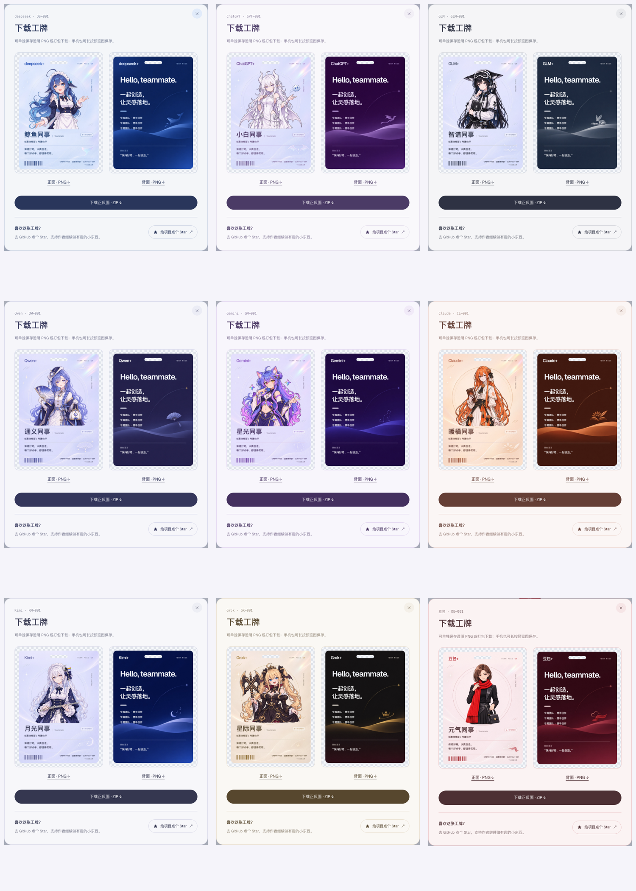

# 工牌编辑模式实测效果

以下图片来自 Chromium 实际页面操作：逐张打开当前 9 位员工的工牌，点选并替换正反面所有可见文字，再完成编辑并打开下载预览。卡面复用原有 CSS，图片保留各角色原有美术和配色。



| 员工 | 编辑后的正反面效果 | 实测项目 |
| --- | --- | --- |
| DeepSeek | [查看原图](deepseek.png) | 全部可见文字替换、3D 贴图更新、下载预览、正反面 PNG、ZIP |
| ChatGPT | [查看原图](gpt.png) | 同上 |
| GLM | [查看原图](glm.png) | 同上 |
| Qwen | [查看原图](qwen.png) | 同上 |
| Gemini | [查看原图](gemini.png) | 同上 |
| Claude | [查看原图](claude.png) | 同上 |
| Kimi | [查看原图](kimi.png) | 同上 |
| Grok | [查看原图](grok.png) | 同上 |
| 豆包 | [查看原图](doubao.png) | 同上 |

下载验证包括 ZIP 完整性、独立 PNG 与 ZIP 内图片逐字节一致、1200 × 1688 尺寸、透明圆角及挂孔。另验证刷新恢复、员工和语言隔离、恢复原版、WebGL 不可用时的静态展示，以及 320 / 390 像素宽度下的触屏编辑和下载。

开发服务运行时可复现完整验证：

```bash
python -X utf8 scripts/verify-edit-mode.py
```

默认截图写入 `docs/preview/edited-badges/`；更新本目录的 PR 效果图时运行：

```bash
BADGE_CAPTURE_EFFECTS=1 python -X utf8 scripts/verify-edit-mode.py
```

验证生产预览时，可用 `BADGE_TEST_URL` 指定服务地址。
